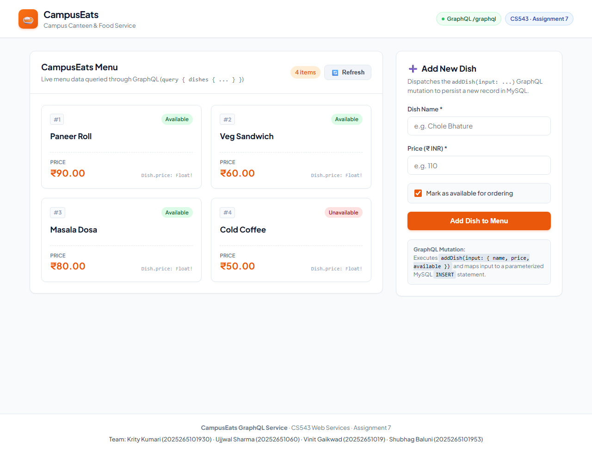
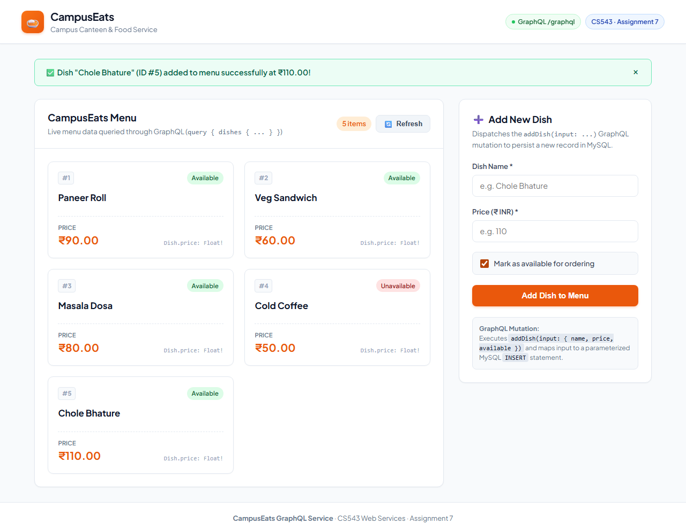

# CampusEats GraphQL Service — Assignment 7

**Course:** CS543 Web Services · Assignment 7 of 12  
**Assignment Title:** Build one CampusEats service in GraphQL  
**Repository:** [https://github.com/Ujjwal2005-12/campuseats.git](https://github.com/Ujjwal2005-12/campuseats.git)  
**Instructor:** Dr. Pramit Mazumdar · `pramit.mazumdar@iiitvadodara.ac.in`  

---

## Team Information

| Name | Roll Number |
|---|---|
| Krity Kumari | 2025265101930 |
| Ujjwal Sharma | 20252651060 |
| Vinit Gaikwad | 20252651019 |
| Shubhag Baluni | 2025265101953 |

---

## Deliverables & Submission Links

- **Demonstration Video (Google Drive):**  
  👉 **`[REPLACE WITH GOOGLE DRIVE VIDEO LINK]`**  
  *(Ensure permission is set to "Anyone with the link can view")*

- **Before-Mutation Screenshot:**  
  [`screenshots/before-mutation.png`](./screenshots/before-mutation.png)

- **After-Mutation Screenshot:**  
  [`screenshots/after-mutation.png`](./screenshots/after-mutation.png)

---

## Required Questions & Answers

### Question 1: Which CampusEats service did you pick?
We selected the **Menu / Catalogue Service** (`dishes` / `Dish` entity).

**Why this service was chosen:**
1. **Core CampusEats Workflow:** The Menu is the central entry point of CampusEats where students browse canteen offerings, inspect prices, and check item availability.
2. **Clean Entity Modeling:** The `Dish` entity has well-defined attributes (`id`, `name`, `price`, `available`) that map directly to standard scalar types in GraphQL (`ID!`, `String!`, `Float!`, `Boolean!`).
3. **Focused CRUD Operations:** It allows straightforward, robust SQL mapping (`SELECT` for list and by-ID queries, `INSERT` for mutations) without coupling to external complex state machines (e.g., payment gateways or delivery order lifecycles).

---

### Question 2: Name one field a client can skip and one it cannot (why we use the "!" sign).

- **Field a client CAN skip:**
  1. **In Query Selection Sets:** In GraphQL, a client can skip **any field** from its selection set. For example, even though `price: Float!` is non-null in the schema, a client can execute:
     ```graphql
     query {
       dishes {
         id
         name
       }
     }
     ```
     Here, the client skips `price` and `available` entirely.
  2. **In Mutation Input:** In `AddDishInput`, the field `available: Boolean = true` is optional. The client can omit `available`, and the server defaults it to `true`.

- **Field a client CANNOT skip:**
  In the `AddDishInput` input object, `name: String!` and `price: Float!` are marked with `!`. When executing `addDish(input: { ... })`, the client **must provide both `name` and `price`**. Omitting either results in an immediate GraphQL validation error (`Field "AddDishInput.name" of required type "String!" was not provided.`) before resolvers are executed.

- **Why we use the `!` sign:**
  The exclamation mark (`!`) defines a **Non-Null constraint** in GraphQL:
  - On **Output types** (e.g., `price: Float!`), it is a server guarantee that the resolver will never return `null` when that field is requested.
  - On **Input arguments** (e.g., `input: AddDishInput!`, `name: String!`), it is a client constraint requiring that non-null values must be provided in the request payload.

---

### Question 3: Map it to SQL: which part of your query became the WHERE, and which resolver ran the INSERT?

- **Which part of the query became the `WHERE` clause:**
  In the single-dish query:
  ```graphql
  query {
    dish(id: "3") {
      id
      name
      price
      available
    }
  }
  ```
  The argument `id: ID!` passed into the `dish` query resolver maps directly to the parameter of the SQL `WHERE` clause:
  ```javascript
  // server.js - dish resolver
  const rows = await query(
    'SELECT id, name, price, available FROM dishes WHERE id = ?',
    [id]
  );
  ```
  The client parameter `id = "3"` is passed as a parameterized placeholder `?` to prevent SQL injection.

- **Which resolver ran the `INSERT` statement:**
  The `Mutation.addDish` resolver ran the parameterized SQL `INSERT` statement:
  ```javascript
  // server.js - addDish mutation resolver
  const result = await query(
    'INSERT INTO dishes (name, price, available) VALUES (?, ?, ?)',
    [name.trim(), parsedPrice, isAvailable]
  );
  const newId = result.insertId;
  const rows = await query('SELECT id, name, price, available FROM dishes WHERE id = ?', [newId]);
  return rows[0];
  ```
  The resolver receives the input object, validates the values, executes the SQL `INSERT`, retrieves the generated `insertId`, fetches the stored row from MySQL, and returns the real persisted record.

---

## Architecture & Technology Stack

- **Runtime:** Node.js (ES Modules)
- **GraphQL Engine:** Apollo Server v4 (`@apollo/server`, `@apollo/server/express4`)
- **HTTP Framework:** Express 4
- **Database:** MySQL 8.0 / 9.1 with `mysql2/promise` (connection pooling & parameterized queries)
- **Configuration:** `dotenv` (`.env` with fallback defaults)
- **Frontend:** Plain HTML5, CSS3, Vanilla ES6 JavaScript (Fetch API) — No framework build required
- **Testing:** Automated Chrome E2E via `puppeteer-core`

---

## Project Structure

```text
assignment7-graphql/
├── schema.graphql              # GraphQL SDL schema (Dish, Query, Mutation)
├── schema.sql                  # MySQL database creation, table DDL, and 4 seed rows
├── db.js                       # MySQL connection pool with parameterized query helpers
├── server.js                   # Apollo Server 4 + Express application entrypoint
├── package.json                # Project dependencies, start, dev, and test scripts
├── .env.example                # Example environment variables template
├── .env                        # Local environment configuration (git-ignored)
├── .gitignore                  # Excludes node_modules and .env
├── README.md                   # Full assignment documentation & question answers
├── DEMO.md                     # 1-2 minute video demonstration guide & script
├── test-e2e.js                 # Automated E2E verification & screenshot script
├── public/
│   └── index.html              # Responsive CampusEats frontend UI with fetch() GraphQL
└── screenshots/
    ├── before-mutation.png     # Screenshot with initial 4 seed dishes
    └── after-mutation.png      # Screenshot with added dish (#5) & success notification
```

---

## Database Setup

1. **Start MySQL Service:**
   Ensure MySQL is running on `localhost:3306`.
2. **Execute Schema & Seed Script:**
   ```bash
   mysql -u root -p < schema.sql
   ```
   *(Or without `-p` if root has no password).*
3. **Verify Seed Rows:**
   ```sql
   USE campuseats_graphql;
   SELECT * FROM dishes;
   ```
   **Expected Seed Rows (4 items):**
   1. `Paneer Roll` — ₹90.00 (Available)
   2. `Veg Sandwich` — ₹60.00 (Available)
   3. `Masala Dosa` — ₹80.00 (Available)
   4. `Cold Coffee` — ₹50.00 (Unavailable)

---

## Installation & Running

### 1. Install Dependencies
```bash
cd assignment7-graphql
npm install
```

### 2. Configure Environment
Create `.env` from `.env.example`:
```bash
cp .env.example .env
```
Ensure database credentials match your MySQL instance:
```env
PORT=4000
DB_HOST=127.0.0.1
DB_PORT=3306
DB_USER=root
DB_PASSWORD=
DB_NAME=campuseats_graphql
```

### 3. Start Server
```bash
npm start
```
The server will output:
```text
✅ Connected to MySQL database successfully.
======================================================
🚀 CampusEats GraphQL Service is running!
🌐 Frontend Application: http://localhost:4000/
📊 GraphQL Endpoint:     http://localhost:4000/graphql
======================================================
```

---

## Testing the GraphQL Service

### 1. Web Application
Open your browser at:
```
http://localhost:4000/
```
- The initial 4 seed dishes are loaded via GraphQL and displayed as styled cards.
- Fill the "Add New Dish" form (e.g., Name: `Chole Bhature`, Price: `110`, Available: Checked).
- Click **"Add Dish to Menu"**.
- The page fires the `addDish` mutation, displays a green success confirmation, and updates the list to 5 items without a full-page reload.

### 2. Run Automated E2E Test & Capture Screenshots
```bash
npm run test:e2e
```
This launches headless Chrome, visits the application, captures `before-mutation.png`, executes the mutation via the UI, and captures `after-mutation.png`.

### 3. CLI Testing via cURL

**List Dishes Query:**
```bash
curl -X POST http://localhost:4000/graphql \
  -H "Content-Type: application/json" \
  -d "{\"query\": \"query { dishes { id name price available } }\"}"
```

**Single Dish Query by ID:**
```bash
curl -X POST http://localhost:4000/graphql \
  -H "Content-Type: application/json" \
  -d "{\"query\": \"query { dish(id: \\\"1\\\") { id name price available } }\"}"
```

**Add Dish Mutation:**
```bash
curl -X POST http://localhost:4000/graphql \
  -H "Content-Type: application/json" \
  -d "{\"query\": \"mutation { addDish(input: { name: \\\"Paneer Roll\\\", price: 90 }) { id name price available } }\"}"
```

---

## Screenshots

### Before Mutation (Initial 4 Seed Records)


### After Mutation (Updated 5 Records with Newly Added Dish)

